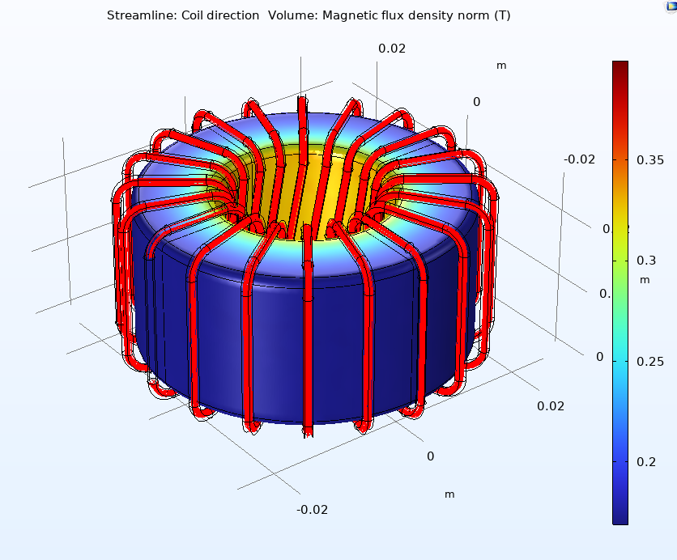
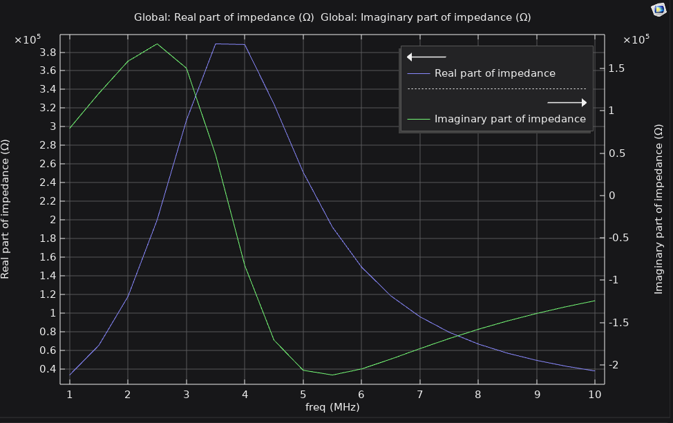
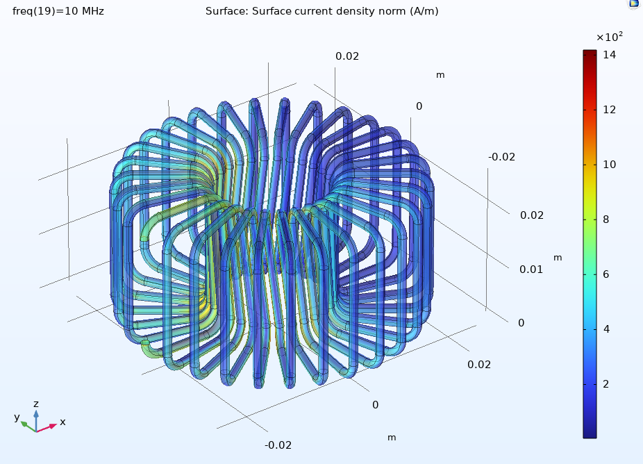

# Toroidal Choke Inductor Design — COMSOL Multiphysics

Finite-element design and analysis of a **toroidal choke inductor** for current-noise filtering, modeled in **COMSOL Multiphysics** (AC/DC Module). The study sweeps the number of turns, wire radius and core material, and characterizes magnetic flux density, DC resistance, inductance and frequency response from 1 to 10 MHz to identify which parameters drive the design.

Developed for *TE2005B – Application of Electromagnetic Theory* at Tecnológico de Monterrey (June 2025), with **Bendix** as industry partner.

<p align="center">
  
</p>

> 📄 **Full report (Spanish):** [`docs/Reporte_Diseno_Inductor.pdf`](docs/Reporte_Diseno_Inductor.pdf)

---

## Key Results

| Configuration | Inductance | Resonant frequency | Peak real impedance |
|---|---|---|---|
| **Baseline** (N = 20, r_wire = 0.75 mm, μr = 1000) | 1.137 mH | ~3.8 MHz | 3.8 × 10⁵ Ω |
| N = 10 | 0.280 mH | ~9.5 MHz | 5.5 × 10⁵ Ω |
| N = 30 | 2.570 mH | ~2.1 MHz | 2.6 × 10⁵ Ω |
| N = 35 | 3.503 mH | ~2.0 MHz | 2.0 × 10⁵ Ω |
| r_wire = 0.5 mm | 1.152 mH | ~4.0 MHz | 4.5 × 10⁵ Ω |
| Ferrite core (μr = 5000) | 5.758 mH | ~2.0 MHz | 3.8 × 10⁵ Ω |
| Low-μ core (μr = 400) | 0.461 mH | ~6.5 MHz | 4.5 × 10⁵ Ω |

**Takeaways**

- **Turns dominate inductance.** Inductance scales roughly with N², from 0.28 mH at 10 turns to 3.5 mH at 35, while DC resistance rises only linearly (7.0 → 24.6 mΩ).
- **Core permeability is the other big lever.** Moving from μr = 400 to 5000 raises inductance by about 12×, because the core confines the flux and cuts leakage.
- **Wire radius mainly affects losses.** Going from 0.75 mm to 0.5 mm more than doubles DC resistance (14.2 → 31.7 mΩ) but barely changes inductance.
- **Higher inductance lowers resonance**, consistent with f₀ = 1 / (2π√(LC)): more turns or higher μr shift the self-resonant frequency down.
- **Operating margin:** driven by a 1 V source through 100 mΩ, the 10-turn coil carries about 9.3 A, well above the 1.5 A continuous rating required by the partner spec, with the core far from saturation.

---

## Model

### Geometry (baseline)

| Parameter | Value | Description |
|---|---|---|
| `N` | 20 | Number of turns |
| `r_wire` | 0.75 mm | Wire radius |
| `core_od` | 12.7 mm | Core outer diameter |
| `core_id` | 7.62 mm | Core inner diameter |
| `core_ht` | 4.75 mm | Core height |
| `core_w` | (core_od − core_id)/2 | Core wall width |
| `W_loop` × `H_loop` | 15 × 25 mm | Winding loop size |
| `r_c_loop` | 3 mm | Winding corner radius |

The geometry is fully parameterized, so each study changes one variable while the rest stay at baseline. Overall assembled size is about 52 mm diameter × 27 mm height.

### Materials

| Domain | Material | Properties |
|---|---|---|
| Winding | Copper | σ = 5.998 × 10⁷ S/m, μr = 1 |
| Core (baseline) | Alloy powder core | μr = 1000, σ = 0 S/m |
| Core (variant 1) | Ferrite | μr = 5000, σ = 10⁻⁶ S/m |
| Core (variant 2) | Low-permeability core | μr = 400, σ = 10⁻⁶ S/m |
| Surroundings and gap | Air | — |

### Physics and studies

- **Magnetic Fields (mf)** coupled to an **Electrical Circuit (cir)**: 1 V source in series with 100 mΩ
- Spherical air domain with a *normal*-size mesh
- **Stationary studies:** air-core vs. cored coil, turn-count sweep (10–40), core-material sweep, wire-radius sweep
- **Frequency-domain studies:** 1–10 MHz sweep of real and imaginary impedance, and surface current density at 10 MHz

<p align="center">
  
  
</p>

---

## Design Recommendations

| Goal | Action |
|---|---|
| Increase inductance | More turns; high-μr, low-conductivity core (ferrite) |
| Lower resonant frequency | Increase inductance as above |
| Raise resonant frequency | Fewer turns or lower-μr core |
| Lower winding losses | Thicker wire (0.5–2 mm is common in industry) |

Core conductivity should stay low; a conductive core induces eddy currents that waste power as heat and reduce effective inductance.

---

## Repository Contents

```
model/
  toroidal_inductor.mph   COMSOL model (solutions and meshes cleared; re-run studies to regenerate)
docs/
  Reporte_Diseno_Inductor.pdf   Full technical report (Spanish)
images/                   Figures used in this README
```

### Opening the model

1. Open `model/toroidal_inductor.mph` in COMSOL Multiphysics with the **AC/DC Module**.
2. Adjust parameters under *Global Definitions → Parameters* (`N`, `r_wire`, core μr).
3. Build the mesh and run the desired study. Solving regenerates all result plots.

> The model is stored without computed solutions to keep it small. The fully solved file (~2 GB) is available [here](LINK_TO_SOLVED_MODEL).

---

## Authors

- Samuel Granados Barrios
- Patricio González Salinas
- **Armando Gordillo Ramírez**
- Andrés González Cantú

Advisors: Dr. Víctor Hugo Pérez González, Dr. Arnoldo Salazar Soto — Tecnológico de Monterrey, Campus Monterrey.
